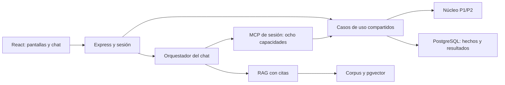

# Crédito Vecino — Sistema de microcrédito con asistente gerencial

Proyecto Final, Grupo 2, sección A, Análisis de Sistemas II (037). Continúa el núcleo P1/P2 en el mismo repositorio. Docente: Ing. Ezequiel Urizar. Entrega prevista en Canvas: 7 de noviembre de 2026, tarea «Proyecto Final — Asistente gerencial».

**Estado de entrega: PARCIAL.** La auditoría de fase 8 está en [su informe de cierre](docs/proyecto-final/08-documentacion-defensa-cierre.md). Hay respuestas incompletas del chat y latencia superior al presupuesto del video; deben resolverse antes de certificar. Video real, ensayo continuo, defensa oral y entrega requieren evidencia externa y no se dan por realizados. No se ha creado `entrega-pf`.

## Instalación desde cero

Requisitos: **[Node.js 22.23.3 LTS](https://nodejs.org/dist/v22.23.3/)**, npm, Git, PostgreSQL con pgvector, Ollama con `qwen3:8b` y `bge-m3`, y Chrome para PDF/recorridos automatizados. `.nvmrc` fija la revisión validada. El mínimo de dependencias es 22.22.2; Node 22.13.0 no es suficiente para el lockfile actual. Docker Desktop es opcional si PostgreSQL y Ollama ya existen de forma nativa. El directorio oficial incluye SHASUMS256.txt para comprobar la descarga.

```powershell
git clone https://github.com/ItsRomero/Proyecto1_Analisis.git
cd Proyecto1_Analisis
git switch feat/proyecto-final-asistente-gerencial
# Registrar el commit a reproducir; para entrega debe ser el auditado, no una rama mutable.
git rev-parse HEAD
# Con nvm instalado; alternativamente instalar Node oficial de la revisión indicada.
nvm install 22.23.3
nvm use 22.23.3
node --version
npm.cmd ci
Copy-Item .env.example .env
```

No es necesario instalar nvm si ya se dispone del runtime correcto. En PowerShell con scripts restringidos usar `npm.cmd`; en otras terminales, `npm`. Si TLS corporativo requiere certificados, configurar una CA confiable (`NODE_EXTRA_CA_CERTS`); nunca desactivar la verificación. No subir `.env` ni imprimir sus valores en evidencia.

La auditoría de fase 8 también documenta un clon **local independiente** del commit `3a4c97a`, sin hardlinks. Estos cambios aún no se han publicado: el clon desde GitHub solo contendrá fase 8 después de su push autorizado. Antes de ello se puede reproducir el snapshot desde una copia del repositorio local con `git clone --no-local --no-hardlinks <ruta-del-repositorio> <destino-nuevo>` y seleccionar ese commit en el clon. El procedimiento y sus resultados están en [instalación limpia](docs/proyecto-final/08-instalacion-limpia.md).

Los insumos oficiales deben existir en `datos/datos-proyecto-final.zip` y en `datos/datos-proyecto-final/`, con eventos, huella, políticas, CSV, LEEME y corpus. `vistas/` conserva la exportación visual de referencia. Si el clon no incluye alguno de esos insumos, obtener el archivo auténtico del equipo/docente y provisionarlo por esas rutas; no crear un sustituto. Comprobar SHA-256 contra el maestro antes de continuar. Nunca copiar node_modules, dist, una base precargada o credenciales de otro checkout para aparentar instalación limpia.

### Preparar PostgreSQL y Ollama

Ejemplo local con Docker; los nombres y puertos se dedican a este proyecto. Si los contenedores ya existen, usar `docker start cv-proyecto-final-db cv-ollama` en vez de recrearlos.

```powershell
docker run --name cv-proyecto-final-db -e POSTGRES_DB=credito_vecino -e POSTGRES_USER=cv -e POSTGRES_PASSWORD=cv_demo_local -p 127.0.0.1:55432:5432 -d pgvector/pgvector:pg17
docker exec cv-proyecto-final-db pg_isready -U cv
docker exec cv-proyecto-final-db createdb -U cv credito_vecino_fase2_test
docker run -d --name cv-ollama -v cv-ollama-modelos:/root/.ollama -p 127.0.0.1:11434:11434 ollama/ollama:0.40.4
docker exec cv-ollama ollama pull bge-m3
docker exec cv-ollama ollama pull qwen3:8b
docker exec cv-ollama ollama list
```

La contraseña mostrada es solo de demostración local. Configurar `.env` de acuerdo con ella o elegir otra consistente en ambos extremos. TEST_DATABASE_URL debe ser una **base distinta**, con nombre terminado en `_test`; las pruebas la reinician. Para repetir la versión histórica, comprobar también digests de imágenes/modelos en `docs/proyecto-final/evidencia/fase5-modelos.txt` y en el reporte de evals. No asumir que una etiqueta mutable conserva el mismo modelo.

Para ejecutar con un rol propio limitado, el administrador puede preparar bases nuevas así (la contraseña se introduce de forma interactiva y luego se configura localmente en `.env`):

```powershell
docker exec -it cv-proyecto-final-db createuser -U cv --pwprompt --no-superuser --no-createdb --no-createrole cv_app
docker exec cv-proyecto-final-db createdb -U cv -O cv_app cv_demo_limitada
docker exec cv-proyecto-final-db createdb -U cv -O cv_app cv_demo_limitada_test
docker exec cv-proyecto-final-db psql -U cv -d cv_demo_limitada -c "CREATE EXTENSION IF NOT EXISTS vector;"
docker exec cv-proyecto-final-db psql -U cv -d cv_demo_limitada_test -c "CREATE EXTENSION IF NOT EXISTS vector;"
```

En ese caso ambas URL usan `cv_app`, su contraseña elegida y los nombres nuevos; migraciones, carga y pruebas se ejecutan con ese rol, sin SUPERUSER. No ejecutar estos comandos sobre una base existente que se quiera conservar. La auditoría del clon usó esta separación entre administrador de infraestructura y rol de aplicación.

| Variable | Configuración |
| --- | --- |
| DATABASE_URL | Conexión privada del servidor a la base de demo en 127.0.0.1:55432, base credito_vecino |
| TEST_DATABASE_URL | Conexión privada a credito_vecino_fase2_test; nunca la base de demo |
| CV_DATA_DIR | `./datos/datos-proyecto-final`; también admite ruta absoluta |
| API_HOST / API_PORT | Loopback y 3000 por defecto; cambiar puerto si está ocupado |
| WEB_ORIGIN / VITE_API_BASE_URL | Origen de Vite para desarrollo; API pública `/v1` en la app unificada |
| DEFAULT_SESSION_CUTOFF | `2026-10-31`; G-7 solicita explícitamente `2027-01-24` |
| OLLAMA_BASE_URL / LLM_PROVIDER / LLM_MODEL | Ollama local, proveedor ollama, qwen3:8b con tool calling |
| EMBEDDING_MODEL / EMBEDDING_DIMENSIONS | bge-m3 / 1024 |
| RAG_TOP_K / RAG_UMBRAL_SIMILITUD | 4 / 0.5; calibración documentada en fase 5 |
| LLM_TEMPERATURE / LLM_TIMEOUT_MS | 0 / 180000 por llamada, según `.env.example`; un turno puede encadenar llamadas |
| CHAT_SESSION_MAX_TURNS / CHAT_SESSION_TTL_MINUTES | 12 / 60; memoria en proceso |
| IDEMPOTENCY_RETENTION_DAYS | 30 para snapshot; vínculo al pago persistente |

Las variables de DB y modelos son solo del servidor, sin prefijo VITE_. Los comandos leen `.env`; las variables ya presentes en el entorno tienen precedencia. `.env.example` contiene el catálogo completo y marcadores, sin secretos.

### Migrar, cargar e iniciar

```powershell
npm.cmd run db:migrate
npm.cmd run carga
npm.cmd run carga          # replay de carga: no duplica ni sobrescribe operaciones
npm.cmd run rag:ingesta
npm.cmd run app            # API y React en http://127.0.0.1:3000
```

Desde base vacía `carga` aplica también migraciones. Verifica preflight y SHA-256 y muestra en verde la huella, 60 clientes, 75 créditos, seis asesores, 228 eventos de pago y 226 pagos únicos aplicados. Cada pago pasa por el núcleo y se guarda por concepto; el log conserva los 363 eventos originales. La segunda carga devuelve `repetida: true` sin modificar operaciones posteriores.

`npm run db:reset` elimina **todos los datos del esquema cv** de DATABASE_URL y reaplica migraciones. Se usa solo para preparar ensayos/Bloque 1. Después de cargar, altas, pagos, aprobaciones y desembolsos se hacen desde la aplicación; no operar cartera con SQL o consola. No reiniciar la base entre OP y G.

En desarrollo: `npm run api` y `npm run web:dev` en terminales separadas; Vite sirve en localhost:5173. Producción local: `npm run app` compila web y sirve todo desde la API. El chat inicia su conexión al primer mensaje. La API lanza MCP por sesión como proceso hijo stdio; no requiere ejecutar otro servidor MCP manualmente. `npm run mcp` existe para clientes stdio configurados con el vínculo de sesión de ADR-020, no como vía alternativa para aprobar pagos. `npm run rag:consulta -- "pregunta normativa"` sirve para diagnóstico de RAG; el guion operativo usa la aplicación.

### Perfil Usuario: inicio, crédito, cuotas y ayuda

La barra superior permite seleccionar **Asesor**, **Gerencia** o **Usuario**. Para ver las pantallas del cliente, seleccionar Usuario y abrir `http://127.0.0.1:3000/usuario`.

| Vista de referencia | Ruta React |
| --- | --- |
| Lista de usuarios (10 por página) | `/usuario` |
| `usuario-inicio-92-3081.html` | `/usuario/inicio` |
| `usuario-detalle-del-credito-92-3310.html` | `/usuario/creditos/:creditoId` |
| `usuario-plan-de-cuotas-92-3528.html` | `/usuario/creditos/:creditoId/plan` |
| `usuario-ayuda-1-92-3822.html` | `/usuario/ayuda` |

`/usuario` muestra todos los clientes, incluidos quienes no tienen créditos, en páginas de 10 con botones Anterior y Siguiente. Al seleccionar una persona se vincula ese cliente a la sesión y se abre `/usuario/inicio`. El enlace **Cambiar de usuario** vuelve a la lista. El número de página se conserva en la URL (`/usuario?pagina=2`).

Los enlaces de Inicio y Mi crédito usan identificadores reales de la base. El selector es de demostración, sin autenticación del cliente. La API pagina la lista sin DPI ni teléfonos y valida el cliente elegido. El perfil Usuario puede consultar ficha, resumen, pagos y plan del cliente seleccionado; se rechazan créditos de otros clientes, operaciones financieras y chat gerencial. Si tiene varios créditos, Inicio muestra todos; si no tiene créditos, se muestra un estado vacío.

Se adapta el diseño móvil de los cuatro prototipos con datos del servidor, sin cargar sus HTML ni copiar cifras de ejemplo. La tasa se etiqueta como nominal anual según el contrato real; el saldo pendiente es capital, no deuda total con cargos. El teléfono ficticio del prototipo no se publica como contacto real.

**Para aplicar este cambio en una instalación ya preparada:** detener la aplicación con `Ctrl+C` y ejecutar:

```powershell
npm.cmd run app
```

Este comando reconstruye React y el backend y verifica las migraciones existentes. No hay dependencias nuevas, variables nuevas ni migraciones adicionales; no hace falta recrear contenedores, repetir `carga` ni `rag:ingesta`. Si nunca se cargaron datos, completar antes el bloque «Migrar, cargar e iniciar». En desarrollo con Vite, reiniciar la API por el nuevo perfil del servidor.

## Arquitectura y pantallas



TypeScript estricto; dinero mediante decimal.js/centavos, fechas y corte explícitos. SQL, React y el modelo no implementan fórmulas financieras. Contratos Zod compartidos en `src/contratos/`; el OpenAPI final se genera con `npm run openapi`. Se conservan las fuentes P1/P2, 21 diagramas `.puml` y su historia.

| Pantalla / ruta | Casos de uso |
| --- | --- |
| Solicitud `/asesor/creditos/nuevo` | Alta, solicitud, simulación, comité y desembolso en el flujo |
| Detalle `/asesor/creditos/:creditoId` | Ficha, estado, saldo, pagos |
| Pago `/asesor/creditos/:creditoId/pagos/nuevo` | Deuda, propuesta, confirmación humana, cancelación; reintento desde comprobante |
| Plan `/asesor/creditos/:creditoId/plan` | Plan con fechas contractuales |
| Mora `/asesor/creditos/:creditoId/mora` | Deuda y explicación de mora |
| Tablero `/gerencia` y `/gerencia/cartera` | Cartera, riesgo, listados por tramo |
| Cierre `/gerencia/cierres/diario` y `/mensual` | Consulta y generación autorizada de cierres |
| Chat `/gerencia/asistente` | Consultas MCP/RAG, citas, propuestas y botones de aprobación |

Las siete pantallas obligatorias conservan correspondencia con P2 y `vistas/`; el chat es una sección integrada adicional. El inventario y las diferencias están en [migración de vistas](docs/proyecto-final/migracion-vistas-react.md).

## MCP, RAG y seguridad

MCP expone siete consultas y `proponer_pago`, sin confirmación ni otras escrituras financieras. Un pago solo se aplica por evento humano de un solo uso, sesión vinculada y revisión transaccional de versión/deuda/idempotencia. Escribir una aprobación en el chat no la concede. El selector de perfil es de demostración; no es autenticación empresarial.

RAG usa LangChain, Ollama, qwen3:8b y bge-m3. La selección local evita enviar cartera a un proveedor externo; bge-m3 es la opción para español del enunciado. Se fragmentan los siete documentos por secciones completas (32 fragmentos en la corrida de fase 5), sin solapamiento ni corte de tablas. Se filtra PII; la recuperación usa coseno, k=4 y umbral 0.5. Las citas se contrastan con lo recuperado; sin evidencia suficiente se informa falta de respaldo.

El corpus es dato no confiable. Sus instrucciones no sustituyen las del sistema; el redactor RAG no tiene herramientas. OP-7 prueba rechazo de instrucciones incrustadas y ausencia de PII/acciones financieras. No se usa una respuesta especial por nombre de archivo. El chat muestra herramienta, corte, resultado y cita; una redacción con decimal/porcentaje sin respaldo se oculta conservando las tarjetas del núcleo.

## Verificación y evidencia

```powershell
npm.cmd run verify
npm.cmd run fase8:preflight
npm.cmd run docs:pdf
```

La verificación general actual tiene **400 pruebas en 32 archivos**, incluida la regresión de la SPA en carpetas ocultas, y no requiere servicios externos, Ollama ni DB. El control completo de fase 8 aprobó **468 pruebas**, cero fallidas y cero omitidas, con Node 22.23.3 sobre el código `3a4c97a`. Véanse [log](docs/proyecto-final/evidencia/fase8-preflight.txt) y [resumen](docs/proyecto-final/evidencia/fase8-resumen-verificacion.json). El total histórico de fase 7 fue 467. No se publica un porcentaje de cobertura no medido.

| Comando | Dependencias / alcance | Tiempo observado fase 8 |
| --- | --- | ---: |
| `verify` | Typecheck núcleo/web y suite general | suite 9.20 s |
| `test:carga:postgres` | Base `_test`; 31 pruebas, incluidos API/MCP/oráculo | suite 53.95 s |
| `test:e2e` | Base `_test`, Chrome, build; 10 recorridos | suite 38.60 s |
| `test:rag` | Base `_test`, Ollama y ambos modelos; seis pruebas | suite 285.94 s |
| `test:chat` | Base `_test`, Ollama y Chrome; 11 pruebas | suite 2006.40 s |
| `evals` | Base `_test`, Ollama; nueve casos y resumen | suite 1603.19 s |
| `fase8:preflight` | Todo lo anterior, carga de demo verificada; detención al primer fallo | total 4031.01 s |

Los tiempos de suite excluyen los builds previos; el total incluye la cadena completa. Son mediciones del equipo actual en CPU, no una promesa para otro equipo ni un ensayo de video. Los comandos de servicios externos fallan si falta su dependencia; no hay skips para aprobar sin entorno. El reporte de evals guarda aprobado/fallido, herramientas, cifras, citas, calidad, commit y estado de partida. `evals:oraculo` reconstruye expectativas desde el núcleo: no usarlo para acomodar un fallo sin investigar.

Los oráculos distinguen POST_CARGA y POST_OP1_OP3. Primero se ejecutan OP-1 a OP-6 y luego G-1 a G-8 sobre la misma base; OP-7 se demuestra en el bloque de seguridad. El guion no contiene cifras financieras escritas como respuestas.

## Reglas y discrepancias del paquete

R-1/R-3: cuota pendiente más antigua completa y deuda exacta. R-2: vencimiento desde el desembolso original, ajustando fin de mes. R-4: gasto solo en políticas habilitadas por JSON. R-5: bajas derivadas con State y autorización de sistema. R-6: reestructurados al día incluidos en riesgo. R-7: duplicados en el log sin efecto adicional. D-1 a D-9 están en ADR-009 a ADR-017.

`IDEM-000068` e `IDEM-000127` son duplicados idénticos. LEEME declara 14/01–31/10/2026, pero los eventos reales van de 07/01 a 30/10; se conservan y el corte de la cartera es 31/10. El ZIP y eventos conservan los hashes del maestro. Datos y vistas son entradas de solo lectura.

## Limitaciones y entrega

- Latencia actual: los nueve turnos G/OP-7 sumaron unos 28.4 min en CPU, sin operaciones ni presentación. G-1/G-2/G-3 salieron truncadas y G-7 ocultó su redacción; ver [revisión de respuestas](docs/proyecto-final/08-revision-respuestas.md). Impide certificar el guion de 15–20 min hasta corregir y ensayar.
- Redacción variable aun con temperatura cero. G-2 se ocultó por una cifra sin respaldo en la corrida de fase 7.
- El verificador no contrasta todos los enteros ni la asociación semántica completa de las cifras. Las tarjetas respaldan la auditoría, pero no garantizan que toda frase sea correcta.
- Sesiones y memoria en proceso; reiniciar el servidor pierde contexto. No se implementa IAM empresarial ni despliegue en nube.
- Video real, participación oral, enlace compartible y entrega Canvas pendientes de evidencia. No hay enlace de video inventado.

### Errores de entorno encontrados en la auditoría

| Síntoma | Causa comprobada / solución |
| --- | --- |
| TS2307: faltan Express/MCP/LangChain | node_modules no correspondía al lockfile; seleccionar el Node compatible y ejecutar npm ci. |
| EBADENGINE o errores con jsdom en Node 22 antiguo | Usar la revisión de `.nvmrc`; no basta cualquier versión 22. |
| La medición histórica de G-2/G-3 lee respuestas vacías | Grabación convertida a CRLF; el checkout actual fija LF sin cambiar su contenido ni aserciones. |
| Nueve recorridos esperan controles que no aparecen | `.env` antiguo con URL absoluta a otra API: actualizar solo VITE_API_BASE_URL a `/v1` y reconstruir web. |
| SPA devuelve 404 dentro de una carpeta con punto | Corregido en 3a4c97a usando root explícito de sendFile; no habilitar globalmente archivos ocultos. |
| Timeout de llamadas con configuración anterior | Contrastar LLM_TIMEOUT_MS con `.env.example` (180000 por llamada). Ese límite no garantiza la duración del video ni sustituye medir la latencia. |

PDF: [PF_AsistenteGerencial_2.pdf](PF_AsistenteGerencial_2.pdf). Fuente editable: [HTML](docs/proyecto-final/PF_AsistenteGerencial_2.html). Generación gratuita con Playwright/Chrome ya declarados en el proyecto: `npm run docs:pdf`; revisión y páginas en evidencia de fase 8.

Documentos: [auditoría final](docs/proyecto-final/08-auditoria-final.md), [guion](docs/proyecto-final/08-guion-video.md), [guía de defensa](docs/proyecto-final/08-guia-defensa-interna.md), [matriz requisito/prueba/evidencia](docs/proyecto-final/07-matriz-requisitos-pruebas.md), [informe de fase 7](docs/proyecto-final/07-pruebas-evals-seguridad.md), [ADR](docs/adr/). La etiqueta de entrega se crea solo tras aprobar la auditoría con evidencia crítica completa.

## Equipo y herramientas de apoyo

| Integrante | Carné |
| --- | --- |
| Christopher David Herrera Pérez | 7690-20-20773 |
| Erwin Alberto Ramírez Racancoj | 7690-23-2387 |
| Gabriela Elízabeth Noemí Aguilar Vásquez | 7690-23-13249 |
| Oliver Fernando Romero Esquite | 7690-23-7366 |

Codex apoyó la preparación de prompts, arquitectura/contratos, carga, pruebas y documentación en las fases registradas en esta sesión. Según la declaración del usuario, Claude Code generó las fases 3–7; sus commits e informes permiten revisar esos entregables. La fase 8 registra nuevas verificaciones, correcciones de reproducibilidad y documentos. No se atribuyen entrevistas, revisión humana completa, intervenciones orales ni porcentajes de autoría no acreditados. El equipo debe revisar y poder defender el sistema.

La documentación histórica de P1/P2 permanece en `docs/`, con sus ADR, diagramas y trazabilidad. El README anterior puede consultarse en Git (`ba90a7c:README.md`); sus conteos y estados históricos no sustituyen esta guía.

```text
Proyecto1_Analisis/
  src/dominio/             núcleo P1/P2
  src/aplicacion/          casos de uso
  src/contratos/           Zod compartido
  src/api/                Express y sesión
  src/persistencia/       migraciones y carga
  src/mcp/  src/rag/  src/chat/
  web/                    React + Vite + Tailwind
  tests/                  pruebas y evals
  scripts/                preparación y documentación
  docs/                   ADR, diagramas y evidencia
  datos/  vistas/         insumos de solo lectura
```
