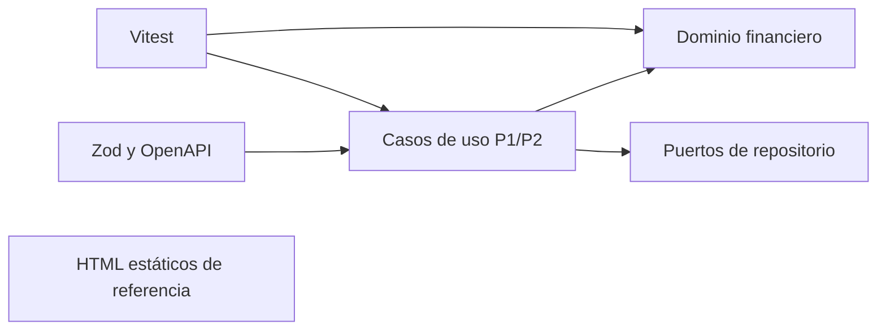
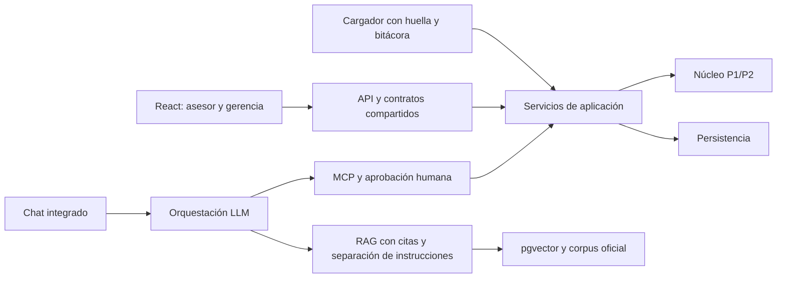

# Fase 0 — Auditoría y línea base

Fecha de revisión: 13 de octubre de 2026. Estado: **PARCIAL**.

Se auditó el checkout real `833851a`, no `main` integrado. No se avanzó a fase 1. El núcleo, las pruebas heredadas, las vistas y los datos de entrada se conservaron sin modificaciones. Esta revisión genera documentación, evidencia y un script independiente; no implementa el Proyecto Final.

## Git y conservación del trabajo

| Elemento | Resultado observado |
| --- | --- |
| Rama activa | `feat/proyecto-2-evolucion-nucleo` |
| HEAD | `833851a5fab29c0c615c631d9c1cc6ed2be60a86`, mensaje `data generada` |
| Trabajo no publicado | `git log --branches --not --remotes` muestra `833851a`; rama activa un commit por delante de su tracking local |
| Archivos inicialmente sin seguimiento | `Prompt_Fase_0_Auditoria_Linea_Base.md`, `Prompt_Fase_1_Arquitectura_Contratos_Integracion.md` |
| `main` local | `183dc71fb578583edb445ef127629431e4ddcc9b` |
| `origin/main` disponible | `00192c98bcdbc704dde7cd03dc4942626df7acfb` |
| Comparación | `git rev-list --left-right --count main...origin/main`: `0 16` |
| Integración en HEAD actual | Ni `183dc71` ni `00192c9` son ancestros de HEAD; `git merge-base --is-ancestor` devuelve 1 para ambos |
| Etiqueta `entrega-p1` | Resuelve a `8737d9b782772a5cff9acb07de8d719f4f4e3a16`, sin moverla |
| Remoto | `https://github.com/ItsRomero/Proyecto1_Analisis.git` |
| Sincronización | `git fetch origin` primero encontró restricción de escritura en `.git/FETCH_HEAD`; el reintento autorizado falló por `SSL certificate problem: unable to get local issuer certificate` |

Las referencias `origin/*` son las disponibles localmente; no se afirma que reflejen el servidor al momento de esta auditoría. No se deshabilitó la validación TLS.

La regla global 3 del maestro exige conservar y detenerse si hay trabajo local no integrado. Por ello no se actualizó `main`, no se creó la rama final, no se hizo commit ni push. Las comprobaciones independientes se realizaron sobre el checkout existente. Hace falta decidir cómo conservar e integrar `833851a` antes de preparar la rama final desde `main` actualizado.

## Entorno y validación

Node observado: `v22.13.0`; npm: `10.9.2`; Python: `3.13.2`. PowerShell bloquea `npm.ps1`; se utilizó `npm.cmd` sin modificar la política de ejecución.

| Comando | Resultado | Evidencia |
| --- | --- | --- |
| `npm.cmd ci --offline --cache .npm-cache` | Código 0; 51 paquetes instalados desde caché | `evidencia/npm-ci.txt` |
| `npm.cmd run typecheck` | Código 0; sin errores | `evidencia/typecheck.txt` |
| `npm.cmd test` | Código 0; 18 archivos y 263 pruebas aprobados | `evidencia/tests-inicial.txt` |
| `npm.cmd run verify` | Código 0; typecheck y 263 pruebas aprobados, 18 archivos | `evidencia/verify-final.txt` |

No se modificaron ni omitieron pruebas para obtener esos resultados. La línea base esperada queda confirmada para HEAD actual, pendiente de repetirla sobre la rama integrada final. `package.json` todavía declara Node `>=20.0.0` y no hay `.nvmrc`; la actualización contractual a Node 22 queda pendiente por la detención de integración.

## Matriz P1/P2/Final

| Requisito | Evidencia | Archivo/commit | Estado | Brecha |
| --- | --- | --- | --- | --- |
| Dominio TypeScript estricto | `strict`, `noImplicitAny` y typecheck aprobado | `tsconfig.json`, `evidencia/typecheck.txt` | CUMPLE | Revalidar tras integrar |
| Dinero decimal y redondeo | Decimal, escala 2 y ROUND_HALF_UP | `src/dominio/dinero.ts` | CUMPLE | No trasladar cálculos a UI |
| Amortización francesa | Fábrica y ajuste de última cuota; suite aprobada | `src/dominio/plan-amortizacion.ts` | CUMPLE | Las cuotas no incluyen fechas contractuales |
| Prelación e idempotencia | Dominio y puerto de repositorio; pruebas aprobadas | `src/dominio/prelacion-pago.ts`, `src/dominio/pago-idempotente.ts`, `src/aplicacion/registrar-pago.ts` | CUMPLE | Falta adaptador persistente operativo |
| Políticas coexistentes | Resolver por fecha y constantes | `src/dominio/politica-mora/catalogo-politicas.ts`, `configuracion-politica.ts` | PARCIAL | No se inyecta `politicas.json` |
| Gasto idempotente | Día 31 y clave crédito/cuota/concepto | `src/dominio/gasto-gestion-cobro.ts` | PARCIAL | No recibe política: podría cobrar también a plana |
| Incobrable autorizado | Exige atraso mayor de 120 y autorización | `src/dominio/credito-estado.ts:176` | CUMPLE | La derivación canónica aún necesita evidencia trazable |
| Fachada P1 y motor P2 | Métodos estáticos y motor inyectado; orquestación por fecha | `src/dominio/calculadora-mora.ts:177`, `src/aplicacion/consultar-mora.ts` | CUMPLE | No usar fachada libre como sustituto del caso de uso P2 |
| Cartera por tramo y reestructurados | Agrupación y bajas explícitas | `src/dominio/cartera-por-tramo.ts` | CUMPLE | El cargador debe construir estados y bajas válidos |
| Contratos compartidos | Esquemas y presentadores existentes | `src/contratos/esquemas.ts`, `presentadores-p2.ts` | PARCIAL | Ampliar para API/MCP final sin duplicarlos |
| OpenAPI | 14 operaciones declaradas; TTL sugerido de 24 horas | `docs/api/openapi.yaml:433`, `tests/openapi.test.ts` | PARCIAL | Contrato no equivale a servidor HTTP |
| Integración completa P2 | Documentación y ADR-005 existen en referencia remota local, faltan en checkout | `00192c9:docs/proyecto2/`, `00192c9:docs/adr/ADR-005-pwa-trabajo-sin-conexion.md` | PARCIAL | Integrar historia sin perder commit local |
| Vistas de referencia | 55 HTML de pantallas y recursos presentes | `vistas/docs/screens.json`, `navigation.json` | PARCIAL | 141 destinos frente a 139 rutas; QA visual pendiente |
| Paquete auténtico | Hashes coincidentes y reproducción sin diferencias monetarias | `evidencia/reproduccion.json` | CUMPLE | Verificado en ubicación alternativa |
| Estructura Anexo C | `vistas/` presente; `datos/` ausente | Inventario de `faltantes_contractuales` | NO CUMPLE | El contenido se encuentra en `data/` |
| Persistencia/cargador operativo | Dependencias y árbol no contienen implementación final | `package.json`, `src/` | NO CUMPLE | Fase 2 |
| API HTTP y siete pantallas React | Vistas estáticas; no hay React/Vite ni servidor en dependencias | `package.json`, `vistas/docs/README.md` | NO CUMPLE | Fase 3 |
| Cierres y devengo diario operativo | Existe diagrama y `DevengoInteres`, no servicio de cierre ni mayor persistente | `docs/diagramas/uml/07-actividad-cierre-mensual.puml`, `src/dominio/devengo-interes.ts` | NO CUMPLE | Extender aplicación; no confundir política de devengo con cierre |
| MCP y aprobación humana integrada | Sin servidor ni SDK MCP | `package.json`, `src/` | NO CUMPLE | Fase 4 |
| RAG, embeddings y chat | Sin canalización, base vectorial ni chat integrado | `package.json`, `src/` | NO CUMPLE | Fases 5–6 |
| Evals del asistente | Suite actual prueba P1/P2 | `tests/` | NO CUMPLE | Fase 7 |
| PDF final y video | No se dispone de entregables finales verificables | Árbol de trabajo | NO VERIFICABLE | Fase 8 y grabación real |
| README actualizado | Insignia 206, 10 archivos, raíz antigua y 18 diagramas; se cuentan 21 `.puml` | `README.md:62`, `README.md:161`, `README.md:244`, `README.md:264` | PARCIAL | Corrección prevista en fase 8 |

Los enunciados PDF referenciados no están presentes en este checkout. La comparación con el Anexo C se limita a los requisitos transcritos en el maestro; no se afirma una lectura directa de esos PDF.

## Arquitectura actual y objetivo





El segundo diagrama es un objetivo, no una implementación existente. El LLM consulta y redacta; los resultados financieros se obtienen del núcleo.

## Siete pantallas y tres recorridos

| Pantalla | Referencia local |
| --- | --- |
| Solicitud y alta de cliente | `vistas/asesor-nuevo-cliente-1-85-873.html` y familias `asesor-nuevo-cliente-*`, `asesor-solicitar-credito-*` |
| Detalle de crédito | `vistas/asesor-detalle-del-credito-11-591.html` |
| Registro de pago | `vistas/asesor-registrar-pago-12-1309.html`, confirmación y pago aplicado |
| Plan de amortización | `vistas/asesor-plan-de-amortizacion-12-741.html` |
| Detalle de mora | `vistas/asesor-detalle-de-mora-12-1040.html` |
| Tablero gerencial | `vistas/gerencia-prototipo-microcreditos-web-103-7192.html` |
| Cierre diario/mensual | `vistas/gerencia-cierre-1-103-9199.html` y variantes 2–3 |

Recorridos identificados en `vistas/docs/README.md`: alta → solicitud → simulación; detalle → pago → confirmación → resultado; tablero/cartera → cierres. Son recorridos visuales, sin transacciones reales. Las referencias documentales P2 integradas se pueden consultar con `git show origin/main:docs/proyecto2/e3-prototipo-figma.md` y los wireframes de esa misma referencia, sin cambiar el checkout.

El preflight visual pasa para index, README, CSS y assets. Se cuentan 55 frames (37 asesor, 7 usuario, 11 gerencia) y 55 HTML sin el índice. `navigation.json` contiene 139 rutas y todos sus destinos existen. `screens.json` contiene 141 destinos: no se equiparan ambos conteos. `verification.json` declara 139 comprobaciones y reconoce que el renderizado en navegador no fue verificado. No se realizaron nuevas pruebas visuales ni se certifican las correcciones responsive o heurísticas.

## Paquete y reproducción R-1 a R-7

Se utilizó temporalmente `CV_DATA_DIR=./data/datos-proyecto-final`, indicando explícitamente la ubicación real; no se movió ni corrigió la fuente. La configuración contractual pendiente es `./datos/datos-proyecto-final`.

Faltan exactamente las siguientes entradas contractuales:

- `datos/datos-proyecto-final.zip`
- `datos/datos-proyecto-final/eventos.jsonl`
- `datos/datos-proyecto-final/eventos.sha256`
- `datos/datos-proyecto-final/politicas.json`
- `datos/datos-proyecto-final/LEEME.md`
- `datos/datos-proyecto-final/corpus/`

El contenido equivalente sí existe bajo `data/`. No es necesario inventar ni regenerar el ZIP.

Hash ZIP observado: `1d9cc4471f25f8bab795f45c1f3fae36a50b76116cb58062a5dc2b46a5c37b0b`.

Hash eventos observado: `e2d46283de8578f19ea2eb14ace283573ebb729aaa0e9b0e65f80a348e4b9d50`, coincide con `eventos.sha256` y con el maestro.

Reproducción desde PowerShell:

```powershell
$env:CV_DATA_DIR = './data/datos-proyecto-final'
python scripts/auditoria/linea_base.py --zip data/datos-proyecto-final.zip --output docs/proyecto-final/evidencia/reproduccion.json
```

El script usa Decimal con precisión 40 y ROUND_HALF_UP, fechas explícitas y lectura de políticas del paquete. No importa el núcleo TypeScript ni escribe en una base. El código de salida es 1 si encuentra diferencias monetarias o huella interna inválida. El JSON conserva resultados de auditoría, no oráculos de producción ni datos personales.

| Regla | Resultado independiente | Límite |
| --- | --- | --- |
| R-1 | 226 pagos únicos reproducidos sobre la cuota pendiente más antigua; cero diferencias | No demuestra el cargador futuro |
| R-2 | Fechas mensuales reproducen los pagos; G-7 obtiene 45 días para cuota 2 al 24/01/2027 | El ajuste de fin de mes es convención propuesta, no verificable en historia con desembolsos de días 1–28 |
| R-3 | Cuota francesa + mora sobre capital de cuota + gasto aplicable coincide al centavo en los 226 pagos | Validación de monto exacto debe añadirse al caso de uso sin romper pagos parciales heredados |
| R-4 | Política de gasto solo nueva; los pagos históricos reproducidos no requieren gasto | Falta condicionar el servicio existente por política |
| R-5 | Derivados: `CV-2026-0015` el 22/10 y `CV-2026-0022` el 27/10 | No se invoca ni modifica State; ADR de evidencia pendiente |
| R-6 | `0201`, `0202`, `0203` reestructurados, todos al día | Su integración en riesgo debe probarse luego con el núcleo/cargador |
| R-7 | Diez créditos con política nueva; selección por vigencia desde 01/10 | Catálogo operativo todavía usa constantes |

Conteos: 60 clientes, 75 desembolsos, 228 eventos de pago; secuencia continua 1–363. Los duplicados `IDEM-000068` y `IDEM-000127` son idénticos salvo `seq` y se omiten en el efecto independiente. Rango real 07/01–30/10/2026; se conserva la discrepancia declarada con LEEME sin editarlo.

Situación inicial, antes de operaciones de demostración:

| Crédito | Pagadas | Vencidas | Días de atraso |
| --- | ---: | ---: | ---: |
| `CV-2026-0043` | 0 | 2 | 55 |
| `CV-2026-0035` | 1 | 3 | 70 |
| `CV-2026-0061` | 0 | 1 | 8 |
| `CV-2026-0015` | 2 | 4 | 130 |
| `CV-2026-0030` | 2 | 3 | 65 |
| `CV-2026-0410` | 0 | 0 | 0 |

Coincide con la tabla del maestro para los campos comparables. La reproducción no contrasta todavía cada plan e importe contra ejecución del núcleo TypeScript: esa comprobación cruzada queda pendiente tras resolver la base Git. No se convierte esta reproducción en implementación financiera de producción.

## Brechas que no deben propagarse

`vistas/docs/README.md` reconoce que importes y fechas provienen de Figma y que pagos, aprobación, sincronización y cierres son demostraciones. No deben tomarse como evidencia operativa. El anexo consultado desde `origin/main:docs/proyecto2/anexo-b-correcciones-figma.md` pide corregir mora, gasto, amortización y agregar confirmación de desembolso; es una instrucción de corrección, no prueba de su implementación. El alcance histórico del anexo tampoco sustituye la restricción actual de gasto solo para política nueva.

La originación deberá incluir autorización y desembolso real; el cierre visual no equivale a cierre mensual implementado. Las revisiones heurísticas y responsive requieren evidencia visual nueva. Las inconsistencias del README quedan registradas para fase 8; no se modifica documentación heredada durante esta detención.

## Decisiones pendientes de ADR

| ID | Decisión pendiente |
| --- | --- |
| D-1 | Baja incobrable derivada con fecha, autorización y evidencia de carga |
| D-2 | Monto exacto en aplicación; conservar pagos parciales del núcleo |
| D-3 | Condicionar generación de gasto a política nueva |
| D-4 | Validar e inyectar `politicas.json` con compatibilidad heredada |
| D-5 | Último día del mes cuando no existe el día contractual |
| D-6 | Aprobación de comité dentro del flujo de originación |
| D-7 | Próximos vencimientos en `(corte, corte + N días]` |
| D-8 | Desembolsos y recuperaciones por concepto en cierres |
| D-9 | Resolver TTL de idempotencia conforme a ADR-005 |

Numerar nuevos ADR desde ADR-006 una vez incorporada la documentación integrada. No se generaron decisiones definitivas de arquitectura en esta fase.

## Bloqueos y siguiente paso

1. Resolver conservación/integración del commit local `833851a` y los prompts sin seguimiento. La regla global 3 impide cambiar la base sin resolverlo.
2. Corregir la confianza de certificados para completar `git fetch`; no afirmar sincronización con referencias antiguas.
3. Preparar `main` actualizado y la rama `feat/proyecto-final-asistente-gerencial`, y repetir la línea base allí.
4. Acordar la ubicación contractual `datos/` preservando el paquete auténtico presente en `data/`.
5. Conciliar 141 destinos del inventario frente a 139 rutas verificadas y realizar QA visual cuando corresponda.
6. Completar contraste independiente contra el núcleo en la base integrada y registrar los ADR en fase 1.

## Informe de cierre

FASE: 0. ESTADO: PARCIAL.

CAMBIOS REALIZADOS: auditoría, matriz, diagramas y reproducción independiente con evidencia. ARCHIVOS: este informe, `scripts/auditoria/linea_base.py` y archivos de `evidencia/`.

COMANDOS Y RESULTADOS: instalación, typecheck, tests, verify y reproducción aprobados; fetch falló por certificado. PRUEBAS: 263 aprobadas, cero fallidas, cero omitidas; 18 archivos, tanto antes como en verificación final.

DECISIONES: conservar el checkout por trabajo no integrado; auditar la fuente real mediante variable temporal en lugar de moverla; no implementar funciones finales. RIESGOS O BLOQUEOS: Git no integrado, fetch no verificable y ubicación contractual ausente.

PENDIENTE PARA LA SIGUIENTE FASE: cerrar los bloqueos anteriores antes de iniciar fase 1. GIT: rama actual `feat/proyecto-2-evolucion-nucleo`; commit de base `833851a`; sin commit de auditoría ni push. No se declara completado el criterio de salida global.
