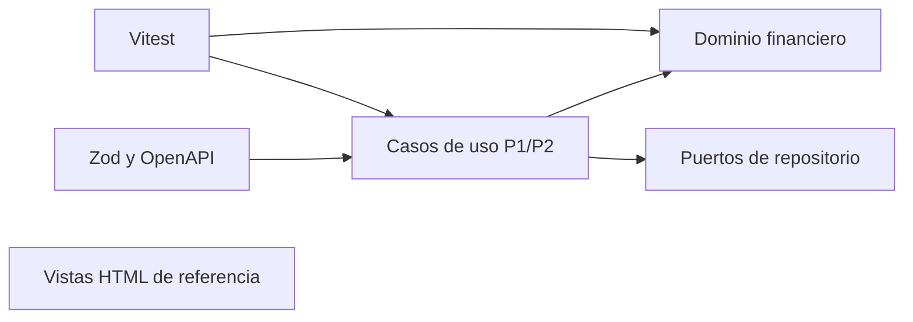
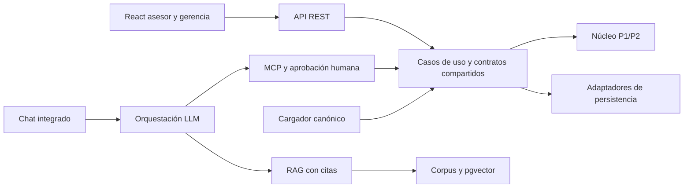

# Fase 0 — Auditoría, sincronización y línea base

Fecha: 13 de octubre de 2026. **ESTADO: COMPLETA**.

Se repitió la auditoría después de la sincronización realizada por el usuario. Se verificó la base integrada, se preservó el trabajo local, se preparó la rama final y se confirmó el paquete original contra una reproducción independiente y el núcleo TypeScript real. No se inició la fase 1 ni se implementaron funciones del Proyecto Final.

El diagnóstico anterior se conserva en `00-auditoria-linea-base-primera-revision.md`. Este informe lo sustituye; las brechas de implementación de fases posteriores no impiden cerrar una fase de auditoría.

## Git y conservación

| Comprobación | Resultado |
| --- | --- |
| Fetch | `git -c http.sslBackend=schannel fetch origin`, código 0, usando certificados de Windows y sin desactivar TLS |
| `main` / `origin/main` | Ambos en `00192c98bcdbc704dde7cd03dc4942626df7acfb`; divergencia `0 0` |
| Inicio de la revisión | Rama P2 en `2fbd5a1`, merge de `main`; conserva el commit local `833851a` |
| Rama final | Creada mediante `git switch -c feat/proyecto-final-asistente-gerencial main` |
| Incorporación de insumos locales | `git merge --ff-only feat/proyecto-2-evolucion-nucleo`, hasta `2fbd5a1`, sin reescribir historia |
| PR #1 y PR #2 | `183dc71` y `00192c9` son ancestros de HEAD, comprobados con `git merge-base --is-ancestor` |
| Trabajo local | `833851a` sigue siendo ancestro; rama original conservada, sin reset, clean ni force push |
| Tag P1 | `entrega-p1` sigue en `8737d9b782772a5cff9acb07de8d719f4f4e3a16` |
| Dominio y pruebas | `git diff --quiet main -- src tests`, código 0 |
| Publicación | Sin push en esta fase |

Los prompts y los archivos de auditoría inicialmente sin seguimiento se conservaron. La instrucción del usuario de repetir la fase después de sincronizar se aplicó sobre la historia integrada, incorporando los insumos locales sin perder su commit. El commit de cierre se identifica con `git log -1 --oneline -- docs/proyecto-final/00-auditoria-linea-base.md`.

## Entorno y comandos

Node `v22.13.0`, npm `10.9.2`, Python `3.13.2`. Se usa `npm.cmd` porque PowerShell restringe `npm.ps1`. Se actualizaron `engines.node` a `>=22` en manifiesto y lockfile, y `.nvmrc` a `22`, conforme a la regla global 16. No se cambiaron dependencias ni el dominio.

| Comando | Resultado | Evidencia |
| --- | --- | --- |
| `npm.cmd ci --offline --cache .npm-cache` | Instalación limpia desde lockfile y caché, código 0 | `evidencia/npm-ci.txt` |
| `npm.cmd test` | 263 aprobadas, 18 archivos, cero fallos u omisiones | `evidencia/tests-inicial.txt` |
| `npm.cmd run typecheck` | Sin errores, código 0 | `evidencia/typecheck.txt` |
| `npm.cmd run verify` | Typecheck y 263 pruebas aprobadas, código 0 | `evidencia/verify-final.txt` |
| Auditoría Python | Huella válida, preflight completo, reproducción sin diferencias | `evidencia/reproduccion.json` |
| Contraste del núcleo | 75 planes y 226 pagos sin diferencias | `evidencia/contraste-nucleo.json` |
| `node --check` | Sintaxis válida en script de contraste y ambos JS de vistas | Comprobación local; no certifica renderizado |

Reproducción desde la raíz del repositorio:

```powershell
$env:CV_DATA_DIR = './datos/datos-proyecto-final'
python scripts/auditoria/linea_base.py --zip datos/datos-proyecto-final.zip --output docs/proyecto-final/evidencia/reproduccion.json
node_modules/.bin/tsc.cmd --noEmit false --outDir dist/auditoria
node scripts/auditoria/comparar-nucleo.mjs
npm.cmd run verify
```

`dist/` está ignorado; el código emitido se usa solo para ejecutar la auditoría del núcleo. Los scripts no son un cargador operativo ni escriben transacciones. La configuración de datos no contiene rutas absolutas. La variable indicada es de proceso/sesión; no se cambió permanentemente el entorno de Windows.

## Matriz de requisitos y brechas

| Requisito | Evidencia | Archivo/commit | Estado | Brecha |
| --- | --- | --- | --- | --- |
| Base integrada y preservación | Ancestría y divergencia verificadas | `00192c9`, `2fbd5a1`, `833851a` | CUMPLE | Commits locales preservados, sin publicación |
| Tag entrega-p1 | Resolución del tag | `8737d9b` | CUMPLE | No se movió |
| Línea base heredada | 263 pruebas, 18 archivos y typecheck | `evidencia/verify-final.txt` | CUMPLE | Revalidar después de cada extensión |
| Node 22 | Runtime, engines y nvmrc | `package.json`, `package-lock.json`, `.nvmrc` | CUMPLE | Ninguna en fase 0 |
| Dominio estricto y dinero exacto | Strict, Decimal, ROUND_HALF_UP | `tsconfig.json`, `src/dominio/dinero.ts` | CUMPLE | No duplicar fórmulas fuera del núcleo |
| Amortización francesa | 75 planes contrastados con Python | `src/dominio/plan-amortizacion.ts`, `evidencia/contraste-nucleo.json` | CUMPLE | Fechas deben componerse fuera del plan actual |
| Idempotencia y prelación | Suite heredada y puerto de repositorio | `src/aplicacion/registrar-pago.ts`, `src/dominio/pago-idempotente.ts`, `src/dominio/prelacion-pago.ts` | CUMPLE | Falta persistencia final |
| Catálogo por fecha | Políticas seleccionadas por vigencia constante | `src/dominio/politica-mora/catalogo-politicas.ts` | PARCIAL | Inyectar politicas.json en futura extensión |
| Gasto idempotente | Clave crédito/cuota/concepto, umbral día 31 | `src/dominio/gasto-gestion-cobro.ts` | PARCIAL | No consulta política; restringir mediante servicio |
| State incobrable | Exige más de 120 días, autorización y evidencia | `src/dominio/credito-estado.ts:176` | CUMPLE | Derivación de carga requiere ADR y evidencia |
| Fachada P1 / motor P2 | Métodos estáticos y motor con política | `src/dominio/calculadora-mora.ts:177`, `src/aplicacion/consultar-mora.ts` | CUMPLE | Usar el caso de uso correcto según contexto |
| Cartera por tramo | Reestructurados en riesgo y bajas con fecha | `src/dominio/cartera-por-tramo.ts`, `src/dominio/cartera.ts` | CUMPLE | Cargador deberá proporcionar estados y bajas |
| Contratos Zod y OpenAPI | Esquemas compartidos, 14 operaciones, errores RFC 9457 | `src/contratos/`, `docs/api/openapi.yaml` | PARCIAL | Ampliar contratos antes de consumidores |
| Documentación P2 integrada | ADR-005, UX/UI, wireframes y validación disponibles | `docs/proyecto2/`, `docs/adr/ADR-005-pwa-trabajo-sin-conexion.md` | CUMPLE | Conservar, no rehacer investigación |
| Vistas e inventarios | 55 frames y 139 conexiones únicas conciliados | `vistas/docs/`, `evidencia/reproduccion.json` | CUMPLE | Renderizado visual en navegador no verificado |
| Insumos Anexo C | Preflight sin faltantes, hashes correctos | `datos/`, `vistas/`, `evidencia/reproduccion.json` | CUMPLE | No editar las fuentes |
| Reglas R-1 a R-7 | Reproducción y límites documentados | Scripts de auditoría y evidencias | CUMPLE | Decisiones de implementación pendientes |
| Persistencia y cargador final | Sin adaptador de base ni cargador operativo | `package.json`, `src/` | NO CUMPLE | Fase 2 |
| API HTTP y React | Prototipos estáticos; sin servidor HTTP ni React operativo | `vistas/docs/README.md`, `package.json` | NO CUMPLE | Fase 3 |
| Cierres operativos y mayor | Diagrama y política de devengo; no cierre ejecutable ni mayor persistente | `docs/diagramas/uml/07-actividad-cierre-mensual.puml`, `src/dominio/devengo-interes.ts` | NO CUMPLE | Servicios de aplicación pendientes |
| MCP y aprobación humana | Sin servidor integrado | `src/`, `package.json` | NO CUMPLE | Fase 4 |
| RAG y chat | Sin canalización ni chat integrado | `src/`, `package.json` | NO CUMPLE | Fases 5–6 |
| Evals del asistente | La suite actual cubre P1/P2 | `tests/` | NO CUMPLE | Fase 7 |
| README coherente | Conviven cifras antiguas y actuales | `README.md:62`, `README.md:161`, `README.md:244`, `README.md:264` | PARCIAL | Fase 8: insignias, raíz, pruebas y 21 diagramas frente a 18 declarados |
| PDF y video final | Sin evidencia final disponible | Árbol local | NO VERIFICABLE | Fase 8 y grabación real |

La comparación con Anexo C se apoya en su transcripción en el maestro. Los PDF de enunciados no están disponibles en el árbol auditado y no se afirma haberlos leído directamente.

## Arquitectura

Actual:



Objetivo, todavía no implementado:



Una sola fuente financiera: el núcleo; API y MCP consumen los mismos casos de uso. El modelo consulta y redacta, sin calcular importes.

## Pantallas, recorridos y brechas visuales

| Pantalla | Archivo fuente en vistas/ | Referencia P2 |
| --- | --- | --- |
| Solicitud y alta | Familias `asesor-nuevo-cliente-*`, `asesor-solicitar-credito-*` | P04–P07, G01–G03 |
| Detalle de crédito | `asesor-detalle-del-credito-11-591.html` | P08 |
| Registro de pago | `asesor-registrar-pago-12-1309.html`, confirmación y pago aplicado | P11–P13 |
| Plan | `asesor-plan-de-amortizacion-12-741.html` | P09 |
| Mora | `asesor-detalle-de-mora-12-1040.html` | P10 |
| Tablero | `gerencia-prototipo-microcreditos-web-103-7192.html` | W01, G04–G05 |
| Cierre | `gerencia-cierre-1-103-9199.html` y variantes 2–3 | G06 |

`docs/proyecto2/e3-prototipo-figma.md` identifica los tres flujos: solicitud → simulación → confirmación → desembolso; búsqueda → saldo/tramo → mora → pago → comprobante; tablero → riesgo por tramo → créditos del tramo. El prototipo termina la originación en solicitud enviada y requiere incorporar aprobación/desembolso; el cierre mensual también está pendiente. Las cifras de mora, gastos y amortización requieren sustitución por resultados del núcleo.

Se confirmaron 55 HTML sin índice: 37 asesor, 7 usuario, 11 gerencia. `screens.json` enumera 141 destinos brutos pero 139 conexiones únicas. Las dos repeticiones son:

- Pantalla `12:1309`, nodo `12:1371`, destino `85:1681`.
- Pantalla `85:1823`, nodo `85:1849`, destino `11:196`.

Todos los destinos de las 139 rutas existen. No se modificaron los inventarios para forzar coincidencias. Los valores 359 enlaces y 216 llamadas a imágenes son declaraciones del informe original `verification.json`, no una nueva medición de esta ejecución. El QA visual en navegador y las correcciones heurísticas no quedan certificados por esta auditoría estática. No se necesita esa certificación para cerrar el inventario de fase 0; sí se necesitará evidencia de la UI real después.

## Paquete auténtico y protección de bytes

`data/` se conservó sin editar como fuente histórica. Se preparó `datos/` con el mismo ZIP y su contenido extraído directamente. Tras el cambio de checkout, `data/.../eventos.jsonl` tenía CRLF y hash `ca682cafea87e0c85d1f47e4165957d80cb095389ccd5b91664093ef70c3bd47`. Se comprobó que solo difería del ZIP por CRLF frente a LF. No se editó ni normalizó el archivo original a mano: la extracción del ZIP auténtico recuperó los bytes oficiales en la ubicación contractual.

`.gitattributes` establece `datos/** -text` para impedir futuras conversiones automáticas de fin de línea. `data/` no es el CV_DATA_DIR operativo.

- SHA-256 ZIP: `1d9cc4471f25f8bab795f45c1f3fae36a50b76116cb58062a5dc2b46a5c37b0b`.
- SHA-256 eventos: `e2d46283de8578f19ea2eb14ace283573ebb729aaa0e9b0e65f80a348e4b9d50`, igual al archivo oficial `eventos.sha256`.
- Preflight completo: index, README, CSS, assets, ZIP, eventos, huella, políticas, LEEME y corpus presentes en sus rutas requeridas.
- 363 eventos con secuencia continua: 60 clientes, 75 desembolsos y 228 pagos; 226 claves de pago únicas.
- Duplicados idénticos salvo seq: `IDEM-000068` y `IDEM-000127`; no se duplicó su efecto en la auditoría.
- Rango observado 07/01–30/10/2026; se conserva sin corregir la discrepancia de LEEME. Corte explícito 31/10/2026.

## Reglas R-1 a R-7 y contraste

El script Python usa Decimal, precisión 40, ROUND_HALF_UP y políticas del paquete. El contraste JavaScript ejecuta el núcleo TypeScript compilado: compara huellas de los 75 planes con los planes independientes y calcula el exigible de los 226 pagos históricos utilizando `CalculadoraMora` con la política correspondiente. No se usa el reloj del sistema. Ningún cálculo se trasladó a código de producción fuera del dominio.

| Regla | Evidencia y conclusión | Decisión aún pendiente |
| --- | --- | --- |
| R-1 | Los 226 pagos coinciden con una cuota pendiente más antigua completa | Validarlo en cargador y servicio |
| R-2 | Vencimientos mensuales reproducen historia; cuota 2 de 0410 da 45 días en G-7 | Fin de mes para OP-3 requiere ADR y prueba; el histórico solo tiene días 1–28 |
| R-3 | 226 exigibles coinciden al centavo con eventos y núcleo | Validación de monto exacto en aplicación sin romper pagos parciales del núcleo |
| R-4 | Pagos históricos son de política plana; sin gastos; JSON limita gasto a nueva | Servicio debe consultar política antes de generar gasto |
| R-5 | Dos bajas derivadas: 0015 el 22/10 y 0022 el 27/10 | Crear evidencia/autorización de sistema sin modificar guarda State |
| R-6 | 0201, 0202 y 0203 reestructurados, al día; el núcleo incluye REESTRUCTURADO en riesgo | Cargador debe construir correctamente su estado |
| R-7 | Diez créditos desde 01/10; política nueva; el núcleo selecciona por fecha | Inyectar políticas oficiales, conservando defaults compatibles |

Situación inicial reproducida, antes de las operaciones de demostración:

| Crédito | Cuotas pagadas | Vencidas | Días de atraso |
| --- | ---: | ---: | ---: |
| CV-2026-0043 | 0 | 2 | 55 |
| CV-2026-0035 | 1 | 3 | 70 |
| CV-2026-0061 | 0 | 1 | 8 |
| CV-2026-0015 | 2 | 4 | 130 |
| CV-2026-0030 | 2 | 3 | 65 |
| CV-2026-0410 | 0 | 0 | 0 |

Coincide con los campos comparables del maestro. G-7 se verifica aparte al 24/01/2027: 45 días para cuota 2 de 0410. Las bajas son derivaciones de auditoría, no transiciones persistidas. No se ejecutaron OP-1 a OP-7 ni se afirma que exista integración operativa.

## Decisiones pendientes de ADR para fase 1

| ID | Decisión y restricción |
| --- | --- |
| D-1 | Baja derivada con fecha y evidencia/autorización; mantener guarda State |
| D-2 | Monto exacto en aplicación, conservar capacidades heredadas |
| D-3 | Generar gasto solo para POL-2026-10 |
| D-4 | Validar e inyectar politicas.json, defaults retrocompatibles |
| D-5 | Fin de mes cuando no existe el día contractual |
| D-6 | Aprobación dentro del recorrido de originación |
| D-7 | Ventana `(corte, corte + N días]` |
| D-8 | Cierre con desembolsos y recuperaciones por concepto |
| D-9 | TTL de idempotencia conforme a ADR-005 o justificación |

ADR-005 ya está disponible en la base integrada; numerar nuevos desde ADR-006. No se adoptaron aquí las decisiones tecnológicas de fase 1.

## Criterio de salida y cierre

- Núcleo heredado verificado: typecheck y 263 pruebas aprobadas, sin modificaciones a `src/` ni `tests/`.
- Trabajo local preservado en la historia y rama original; prompts y evidencias conservados.
- Paquete auténtico disponible en ruta contractual y protegido contra conversión de bytes.
- Reglas R-1 a R-7 confirmadas en el alcance reproducible; diferencias y decisiones futuras explicadas.
- Vistas e inventarios conciliados con evidencia estática.

No hay bloqueos que impidan cerrar esta fase. Permanecen como riesgos para implementación el QA visual, los insumos externos de LLM y los ADR pendientes; no se inventaron credenciales ni resultados de integración.

FASE: 0.
ESTADO: COMPLETA.

CAMBIOS REALIZADOS: preparación de rama integrada, datos canónicos en ruta contractual, Node 22 declarado, auditoría reproducible y contraste con núcleo.

ARCHIVOS: este informe, revisión histórica, `scripts/auditoria/`, `evidencia/`, `.gitattributes`, `.nvmrc`, manifiesto/lockfile y `datos/`. Se conserva el diagnóstico histórico de fase 1 indicando que ya fue sustituido.

COMANDOS Y RESULTADOS: fetch, instalación, pruebas, typecheck, verify, reproducción y contraste aprobados.

PRUEBAS: 263 aprobadas, cero fallidas u omitidas, 18 archivos. Auditoría: 75 planes y 226 pagos coincidentes.

DECISIONES: conservar historia mediante fast-forward, extraer el paquete original y usar certificados de Windows sin desactivar TLS.

RIESGOS O BLOQUEOS: ninguno para fase 0; limitaciones posteriores descritas arriba.

PENDIENTE PARA LA SIGUIENTE FASE: ejecutar fase 1 solo bajo instrucción del usuario; definir contratos, modelo persistente, ADR y plan de integración.

GIT: `feat/proyecto-final-asistente-gerencial`; base integrada `2fbd5a1`; commit de cierre consultable con `git log -1 --oneline -- docs/proyecto-final/00-auditoria-linea-base.md`; sin push.
