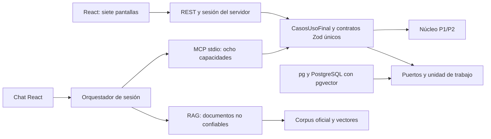
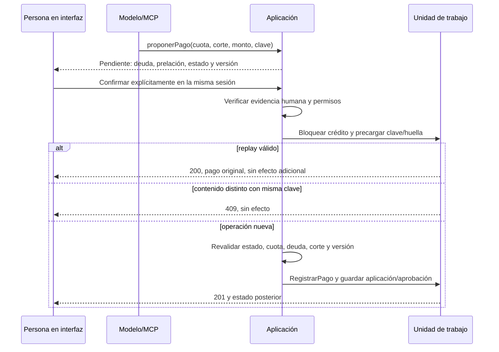

# Fase 1 — Arquitectura, contratos y plan de integración

Fecha: 2026-10-13. Base: fase 0 cerrada en `1eb2fe1`.

Esta fase define el diseño ejecutable de contratos y puertos, implementa la composición del calendario del plan y prueba la traducción HTTP de idempotencia. Los servicios completos, la base, los servidores y la interfaz se implementan en fases posteriores. No se presentan interfaces TypeScript como servicios ya operativos.

## Verificación de entrada

Árbol inicialmente limpio, rama `feat/proyecto-final-asistente-gerencial`, `main` y referencia local `origin/main` sin divergencia. No se cambia la base de fase 0 ni se mueve `entrega-p1`.

- `npm.cmd run verify`: 263 pruebas aprobadas en 18 archivos, typecheck correcto. Evidencia: `evidencia/fase1-verificacion-previa.txt`.
- Auditoría Python con `CV_DATA_DIR=./datos/datos-proyecto-final`: preflight completo y huella oficial válida.
- Contraste del núcleo compilado: 75 planes y 226 pagos sin diferencias. Se reutiliza el procedimiento documentado en fase 0.

## Límites y dependencias

| Módulo | Responsabilidad y dependencias permitidas |
| --- | --- |
| `src/dominio` | Reglas P1/P2, dinero, State y políticas; solo bibliotecas de cálculo/fechas, sin aplicación ni adaptadores |
| `src/contratos` | Zod compartido y manifiesto de operaciones; reutiliza esquemas heredados y validación de FechaCivil |
| `src/aplicacion` | Orquestación, permisos, fechas/corte, transacciones por puertos; depende de dominio y contratos, no de frameworks |
| `src/persistencia` | Implementa puertos de aplicación con pg; almacena hechos y resultados, sin fórmulas financieras |
| `src/api` | Express 5, validación/transporte, sesión, presentación y despacho a casos de uso |
| `src/mcp` | SDK MCP stdio y registro acotado de herramientas; mismas instancias de aplicación que API |
| `src/rag` | Solo corpus, embeddings y citas; no acceso financiero directo ni autorización de escrituras |
| `web/` | React/Vite/Tailwind: renderizado y confirmación humana; sin importar el dominio ni calcular importes |
| `web/src/chat/` | Contexto de sesión, fecha visible, citas y llamadas; consulta al backend, nunca a DB |

La prueba de arquitectura recorre los imports del dominio y falla si sale de su módulo o incorpora frameworks no autorizados. `src/dominio/` y las pruebas heredadas permanecen intactos.



El diagrama describe el objetivo. El contrato `CasosUsoFinal` exige entradas/salidas inferidas de un registro único; no hay implementaciones vacías que devuelvan datos de ejemplo.

## Casos de uso definidos

`src/aplicacion/casos-uso-final.ts` define todos los puertos de entrada. `src/contratos/proyecto-final.ts` define entrada/salida en Zod y tipos inferidos. `rutas-proyecto-final.ts` vincula transportes con esos mismos nombres.

| Operación | Orquestación prevista | Acceso |
| --- | --- | --- |
| altaCliente | Identidad única, municipio, teléfono opcional y fecha explícita | Interfaz con evidencia humana |
| solicitarCredito | Crear estado SOLICITADO y registrar condiciones/actor | Interfaz |
| simularPlan | `simularPlanConVencimientos` compone fábrica francesa y calendario | Interfaz; no persiste crédito |
| aprobarCredito | Invocar transición State autorizada y registrar evidencia | Interfaz GERENCIA |
| desembolsarCredito | Exigir APROBADO, fijar fecha/política y persistir plan del núcleo | Interfaz |
| consultarCredito | Reconstruir a corte, saldo/estado/cuotas/próxima/días/tramo por núcleo | API y MCP |
| consultarPlan | Recuperar plan contractual sin recalcular en cliente | API |
| calcularDeudaCuota | Componer conceptos del núcleo y gasto según política | API y MCP |
| explicarMora | Reutilizar `consultarMora` y presentador P2 para la cuota solicitada | API y MCP |
| listarCreditosMora | Selección por corte/tramo sobre resultados del núcleo | API y MCP |
| proximosVencimientos | Ventana D-7 sobre cuotas pendientes a corte; totales en servicio | API y MCP |
| consultarCartera | Reutilizar `calcularCarteraPorTramo`, incluida baja del período | API y MCP |
| consultarCierre | D-8: consulta PREVIO o snapshot GENERADO sin escribir | API y MCP |
| generarCierre | Snapshot del núcleo, único y auditable | Interfaz GERENCIA |
| proponerPago | Dry-run, deuda, prelación y estado previsto; solo operación pendiente | API y MCP |
| confirmarPago | Evidencia humana y revalidación transaccional; delegar a `RegistrarPago` | Interfaz exclusivamente |
| cancelarPropuesta | Cancelar pendiente sin efecto financiero | Interfaz exclusivamente |

El cierre mensual se refiere al mes de `fechaCorte` hasta ese corte inclusive. El guion de octubre usa 31/10 y cubre el mes completo. Las consultas históricas no deben incorporar pagos, bajas o políticas posteriores al corte.

## Calendario implementado

`src/aplicacion/plan-con-vencimientos.ts` compone el `PlanAmortizacion` sin modificarlo ni copiar su fórmula. Cada vencimiento es desembolso original + k meses, ajustando al último día cuando falte el día. No se encadenan fechas desde febrero. Se conservan las mismas instancias de cuotas, importes y ajuste final del núcleo.

Las pruebas incluyen OP-3 (31/10 → 30/11), enero → febrero → marzo y año bisiesto. Ningún servicio toma la fecha de corte del reloj del sistema.

## Contratos y OpenAPI

Fuente única: `src/contratos/proyecto-final.ts`. Heredados: `src/contratos/esquemas.ts` y presentadores P2. La extensión no duplica dinero/moneda, estados, cuota francesa o respuestas de cartera/mora.

Se conserva `docs/api/openapi.yaml` con sus 14 operaciones para no romper el contrato/pruebas P1/P2. Se actualiza la referencia a la extensión y el TTL. No se montan rutas heredadas de pago que omitan la aprobación. El contrato de implementación final es `docs/api/openapi-proyecto-final.json`, con 17 operaciones generadas desde Zod y su manifiesto.

```powershell
node_modules/.bin/tsc.cmd --noEmit false --outDir dist/auditoria
node scripts/contratos/generar-openapi.mjs
npm.cmd run verify
```

Las pruebas comparan los esquemas generados con Zod para detectar divergencia. Las validaciones runtime de fechas civiles y refinamientos no deben reemplazarse solo por validación JSON Schema. El adaptador convierte parámetros HTTP de path/query (p. ej. número de cuota) antes de validar; no convierte importes a number.

Importes públicos: `{ importe: "100.00", moneda: "GTQ" }`. Tasas decimales como cadena. Fechas `AAAA-MM-DD` reales; se rechazan 29/02/2026 y 31/04. La configuración canónica tiene un esquema Zod específico, incluyendo políticas, tramos y alcance del gasto. La inyección retrocompatible al motor corresponde a fase 2.

## Propuesta, aprobación y transacción



El servidor construye `ContextoOperacion` desde la sesión; el LLM no elige actor, perfil ni evidencia de aprobación. Las mutaciones humanas requieren `ContextoConfirmacionHumana`. Los tipos son una ayuda de diseño, no sustituyen la autorización runtime que debe implementar el adaptador.

Una propuesta liga sesión/crédito/cuota/fecha/monto/clave/huella/versión. Nueva confirmación comprueba pertenencia de sesión, que la cabecera Idempotency-Key coincida con la propuesta, y un evento humano verificable. La fecha de confirmación financiera debe coincidir con la propuesta; cambiarla exige nueva propuesta y aprobación. Una versión modificada devuelve PROPUESTA_OBSOLETA. Reiniciar/expirar sesión invalida pendientes. No hay confirmación por silencio ni por texto del chat.

El repositorio heredado es síncrono. Para pg, el adaptador abre transacción, bloquea crédito y precarga idempotencia antes de invocar `RegistrarPago`. El objeto síncrono devuelve resultado en memoria y la unidad de trabajo persiste pago/aplicaciones/versión/clave/evidencia antes de commit; el fallo de cualquier escritura revierte todo. Esto evita introducir I/O asíncrona imposible dentro del callback heredado. Fase 2/4 debe probar concurrencia y rollback reales.

## Errores uniformes

| Código | HTTP | Comportamiento |
| --- | ---: | --- |
| CREDITO_NO_EXISTE | 404 | Sin filtrar existencia de otros datos |
| CUOTA_YA_PAGADA | 409 | Para operación nueva; replay válido prevalece |
| CREDITO_INCOBRABLE | 409 | No permite nueva escritura |
| MONTO_NO_EXACTO | 422 | Incluye montoCorrecto exacto devuelto por núcleo |
| FECHA_INVALIDA / PERIODO_INVALIDO | 422 | Sin sustituir por fecha actual |
| CONFLICTO_IDEMPOTENCIA | 409 | Misma clave, distinto contenido, sin efecto |
| APROBACION_REQUERIDA / SESION_NO_AUTORIZADA | 403 | Nunca aceptar aprobación del LLM |
| PROPUESTA_OBSOLETA | 409 | Rehacer propuesta y obtener nueva aprobación |
| PROPUESTA_NO_EXISTE | 404 | Sin confirmar una operación arbitraria |
| ERROR_INTERNO | 500 | Mensaje genérico, traceId, sin SQL ni secretos |

Todos usan `application/problem+json` con `ErrorApi` heredado y extensiones explícitas. `presentarProblemaFinal` traduce conflicto/fecha/errores de aplicación sin exponer mensajes internos. La repetición correcta no es error: 200 con `Idempotency-Replayed: true`; primera aplicación 201 con false. Se prueba contra `RegistrarPago` real y un repositorio de prueba con contador de efectos; no se afirma que exista servidor HTTP.

## Persistencia y configuración

`01-modelo-persistente.sql` diseña clientes, asesores, políticas, créditos, transiciones, cuotas fechadas, bitácora, bajas, propuestas, aprobaciones, pagos, aplicaciones, claves, gastos idempotentes, cierres, documentos, fragmentos y vectores. Incluye claves/relaciones/únicos y centavos BIGINT. No incluye fórmulas ni triggers financieros. Los snapshots contienen resultados del núcleo, no fórmulas replicadas.

El SQL no se ejecutó ni se presenta como migración validada. El alta del vector requiere comprobar dimensión 1024 del modelo configurado antes de ingesta. No crear índices de búsqueda aproximada antes de medir su necesidad con siete documentos.

`.env.example` documenta rutas relativas, conexión local de ejemplo, proveedor/modelos, límites de sesión, temperatura, timeout y retención. No contiene credenciales reales ni activa servicios. Las variables VITE_ solo llevan URL pública de API; DB y modelos son del servidor. No se requieren claves de nube con la selección local.

## ADR y trazabilidad

| Requisito | ADR |
| --- | --- |
| Base, acceso y API | ADR-006 |
| Transporte MCP y menor privilegio | ADR-007 |
| LLM con herramientas, embeddings, LangChain y memoria | ADR-008 |
| D-1 bajas derivadas | ADR-009 |
| D-2 exactitud y propuesta | ADR-010 |
| D-3 gasto por política | ADR-011 |
| D-4 catálogo inyectado | ADR-012 |
| D-5 fin de mes | ADR-013 |
| D-6 comité en originación | ADR-014 |
| D-7 ventana de vencimientos | ADR-015 |
| D-8 cierres por concepto | ADR-016 |
| D-9 TTL y unicidad permanente | ADR-017 |

Las referencias primarias del modelo/transporte se documentan en ADR-007/008. Selección técnica no equivale a evaluación del modelo: Ollama/psql no se localizaron en PATH durante esta revisión. No se descargaron modelos, no se creó una base ni se hicieron evals reales.

## Plan de integración posterior

1. Fase 2: migraciones, pg, cargador transaccional, catálogo inyectado y bajas; validar huella/conteos/rollback y conservar eventos duplicados sin duplicar efectos. Implementar servicios sobre hechos persistentes usando estos puertos.
2. Fase 3: Express y React, sesiones de demo, flujos de originación/pago/gerencia y cierres; despachar el registro único de contratos. La UI nunca calcula ni navega a HTML de vistas.
3. Fase 4: SDK MCP stdio, siete consultas y propuesta, confirmación exclusivamente por interfaz; pruebas de menor privilegio y concurrencia.
4. Fase 5: LangChain, ingesta de corpus por secciones, bge-m3/pgvector, citas y defensa frente a instrucciones incrustadas.
5. Fase 6: chat integrado, contexto aislado, cifras por MCP y política por RAG; mostrar origen y corte.
6. Fase 7: regresión, pruebas de integración y evals deterministas; evals reales con modelo en comando aparte.
7. Fase 8: README/PDF/video y auditoría. No se avanzó a ninguna de estas implementaciones durante fase 1.

## Informe de cierre

FASE: 1 — Arquitectura objetivo, contratos y plan de integración.

ESTADO: COMPLETA como fase de diseño y contratos. No acredita integración operativa futura.

CAMBIOS REALIZADOS: límites de capas, 17 contratos de caso de uso, ocho capacidades MCP, calendario compuesto, diseño persistente, propuesta/aprobación, errores, variables, ADR-006 a ADR-017 y OpenAPI generado.

ARCHIVOS: `src/aplicacion/*-final.ts`, `plan-con-vencimientos.ts`, `src/contratos/proyecto-final.ts`, `rutas-proyecto-final.ts`, presentadores en `src/api/`, documentos de adaptadores, `.env.example`, `scripts/contratos/`, dos archivos de pruebas nuevos y documentación/ADR.

COMANDOS Y RESULTADOS: verificación previa correcta (263 pruebas, 18 archivos), generación OpenAPI correcta (17 operaciones y ocho capacidades MCP) y `npm.cmd run verify` final correcto. Evidencia: `evidencia/fase1-verificacion-previa.txt` y `evidencia/fase1-verificacion-final.txt`.

PRUEBAS: 275 aprobadas, cero fallidas u omitidas en 20 archivos; 263 heredadas intactas y 12 nuevas. Typecheck sin errores. Se comprobó que `src/dominio/`, los 18 archivos de pruebas heredadas, `datos/` y `vistas/` no cambiaron frente a `1eb2fe1`.

DECISIONES: PostgreSQL/pgvector + pg, Express 5, MCP stdio, Ollama qwen3:8b, bge-m3, LangChain, memoria por sesión y D-1 a D-9 conforme a ADR.

RIESGOS O BLOQUEOS: sin bloqueo de diseño; instalación PostgreSQL/pgvector y Ollama/modelos, rendimiento, seguridad del transporte y confirmación efectiva quedan por verificar en sus fases. No hay fallos de fase 0 detectados.

PENDIENTE PARA LA SIGUIENTE FASE: implementar persistencia/carga y servicios definidos; no reemplazar estos puertos por duplicación de reglas.

GIT: rama `feat/proyecto-final-asistente-gerencial`, base `1eb2fe1`; commit de cierre consultable con `git log -1 --oneline -- docs/proyecto-final/01-arquitectura-contratos-integracion.md`; sin push.
